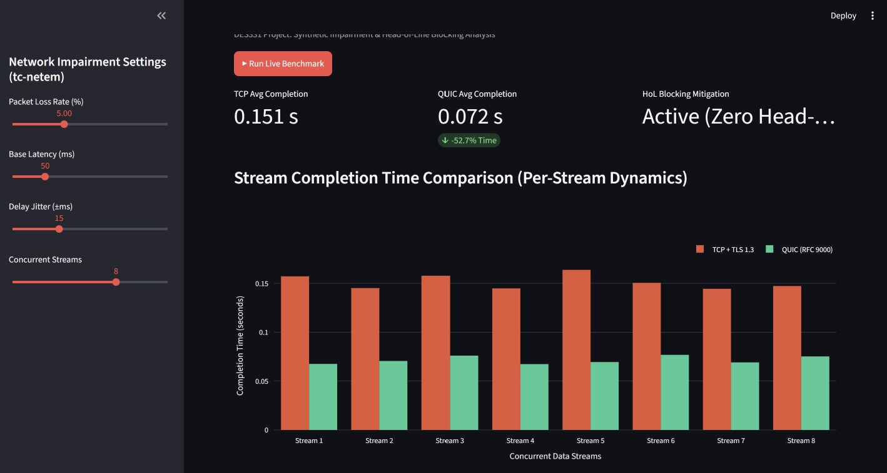

# Comparative Analysis of TCP vs. QUIC under Synthetic Network Impairments

An interactive benchmarking testbed and telemetry platform evaluating transport-layer mechanics (TCP with TLS 1.3 vs. QUIC / RFC 9000) under synthetic edge-network degradation.

## Academic Context
- **Course:** DES331 Computer Network (Section 2)
- **Group:** 13
- **Members:** 
  - 6722771241 Noppatee Ammaro
  - 6722781901 Thanawan Lelavijit

---

## Overview & Key Features
- **Network Impairment Simulation:** Simulates adverse link conditions (packet loss, latency, and jitter) emulating `tc-netem` mechanics.
- **Micro-Level Protocol Profiling:** Evaluates multi-stream Head-of-Line (HoL) blocking and socket buffer stalls under lossy conditions.
- **Interactive Visualization:** Real-time side-by-side telemetry comparison powered by Streamlit and Plotly.

---


## Project Structure
```text
.
├── app.py              # Streamlit dashboard and telemetry simulation engine
├── requirements.txt    # Project dependencies
├── .gitignore          # Git exclusion rules
└── README.md           # Documentation